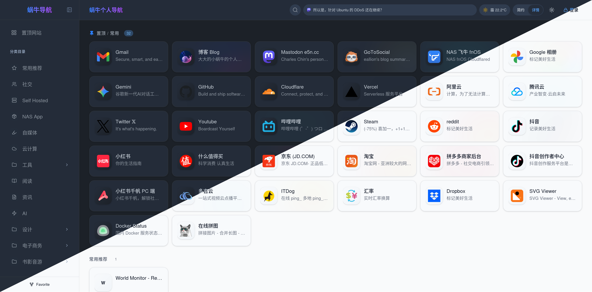

# CloudNav-Worker

> [!WARNING]
> **本项目完全基于 AI 构建，我对项目中的代码一无所知。如果有 Bug 和功能需求请 Fork 后自行处理。**

> [!NOTE]
> **本项目部署到 Cloudflare Workers，使用 Workers Static Assets + KV + R2。**

**一个现代化云端导航 / 书签管理页面。**



## ✨ 特性

- **全分类锚点页面**：所有分类同屏展示，侧边栏一键跳转
- **前端可视化编辑**：右键菜单 / 拖拽排序 / 批量操作 / 分类管理
- **访客模式**：普通用户可正常浏览，登录后获得管理权限
- **私密分类**：独立分类密码由 Worker 验证，未解锁的书签不进入公开搜索或置顶
- **KV 按分类存储**：链接按 `links:{category_id}` 拆分存储，读取时自动聚合
- **Cloudflare Workers 部署**：一个 Worker 同时提供静态页面和 API，使用 KV / R2 存储
- **KV 云端存储**：数据持久化，localStorage 缓存 + KV 双向同步
- **图标缓存**：可抓取网站图标并缓存到 Cloudflare R2
- **AI 辅助**：集成 Gemini / OpenAI 兼容 API，自动填充链接描述、智能分类建议
- **数据导入导出**：Chrome 书签 HTML / JSON 备份 / WebDAV 云同步
- **丰富小组件**：Mastodon / Memos 动态滚动条、实时天气（和风天气）
- **个性化**：深色/浅色模式（自动检测系统偏好）、紧凑/详细视图、自定义图标
- **卡片动效**：从图标提取主色调，hover 时显示彩色边框 and 光晕
- **骨架屏加载**：加载时显示骨架屏占位，卡片交错淡入动画

## 🧩 浏览器插件

你可以配合 **Chrome** /  **Firefox** 浏览器插件来快速添加书签：

- [eallion/chrome-extension-favorite](https://github.com/eallion/chrome-extension-favorite)
- [eallion/firefox-extension-favorite](https://github.com/eallion/firefox-extension-favorite)

[](https://chromewebstore.google.com/detail/nepjakfedadjkpjpideoaobngonilmoi) [](https://addons.mozilla.org/zh-CN/firefox/addon/favorite-assistant/)

## 🏗️ 技术架构

#### 技术栈

- React 19
- TypeScript
- Vite
- Tailwind CSS 4

#### Serverless / Storage

- **Cloudflare Workers**: Workers Static Assets + Workers KV + R2

```
┌──────────────────────────────────────────────┐
│               Browser (Client)               │
│                                              │
│  React 19 + TypeScript + Tailwind CSS 4      │
│  State: Context + useReducer                 │
│  DnD: @dnd-kit                               │
│  Icons: lucide-react                         │
│                                              │
│  Data: localStorage (cache) + KV (persist)   │
└──────────────────┬───────────────────────────┘
                   │ HTTP API
┌──────────────────┴───────────────────────────┐
│     Cloudflare Workers API                   │
│                                              │
│  KV 存储：links:{category_id} 按分类拆分     │
│  认证：安全随机 Token + 自动清理旧 Token     │
│  数据持久化：Workers KV + Cloudflare R2      │
└──────────────────────────────────────────────┘
```

## 🚀 部署指南

使用 **Cloudflare Workers**，通过 Cloudflare 网页控制台完成部署。

[](https://deploy.workers.cloudflare.com/?url=https%3A%2F%2Fgithub.com%2Fkentinya%2Fcloudnav-workers)

全程在网页中完成，无需在本地安装 Node.js、pnpm 或 Wrangler：

1. 登录 Cloudflare，在 **R2 Object Storage** 中按提示开通 R2，本项目使用它存储图标。
2. 点击上方按钮，授权 GitHub，并将项目复制到自己的 GitHub 账号。
3. 在部署页面设置 Worker 名称和管理员密码 **`PASSWORD`**，将示例值替换为自己的密码。
4. 确认构建命令为 **`pnpm build`**、部署命令为 **`pnpm exec wrangler deploy`**，然后点击 **Deploy**。这些命令由 Cloudflare 执行。
5. 等待构建完成，打开提供的 `workers.dev` 地址，用刚设置的密码登录管理界面。

Cloudflare 会自动创建并绑定 `CLOUDNAV_KV` 和 `CLOUDNAV_R2`。如果部署页面未要求填写 `PASSWORD`，部署后进入 Worker 的 **Settings → Variables and Secrets → Add**，选择 **Secret**，添加 `PASSWORD` 并点击 **Deploy**。

完整的网页操作、手动导入仓库、自定义域名和常见问题见 **[Cloudflare Workers 网页部署教程](docs/workers.md)**。按钮使用 Cloudflare 官方的 [Deploy to Cloudflare](https://developers.cloudflare.com/workers/platform/deploy-buttons/) 流程。

公开首页、私密分类和管理员权限的使用与测试方法见 [访问权限说明](docs/access-control.md)。

## ⚙️ 环境变量

| 变量 | 说明 | 必填 | 默认值 |
|------|------|------|--------|
| `PASSWORD` | 管理后台登录密码 | 是 | - |
| `ALLOWED_ORIGIN` | CORS 允许的域名 | 否 | `*` |

## 🛠️ 本地开发

使用 Node.js 22 和 pnpm 11：

```bash
pnpm install --frozen-lockfile
cp .dev.vars.example .dev.vars
# 编辑 .dev.vars 设置本地管理员密码
pnpm dev:worker
```

完整应用运行在 `http://127.0.0.1:8788`，KV / R2 数据保存在本地 `.wrangler/state/`，无需 Cloudflare 登录。
如需前端热更新，在另一个终端运行 `pnpm dev` 并打开 `http://localhost:3000`；API 自动代理到 Worker。

```bash
pnpm test:worker      # Worker 路由、认证、KV 和 R2 测试
pnpm deploy:dry-run   # 本地构建与部署打包验证
```

更多说明见 [Cloudflare Workers 部署说明](docs/workers.md)。

## 📁 项目结构

```
├── worker/                    # Cloudflare Workers 入口、API 路由及测试
│   └── api/                   # Worker API 处理逻辑与 KV 辅助函数
├── wrangler.jsonc              # Workers 静态资源、KV / R2 绑定与运行配置
├── docs/workers.md             # Workers 开发和部署说明
├── components/                # 通用 UI 组件 (Modal, Toast, ErrorBoundary, 小组件等)
├── services/                  # 前端业务逻辑 (AI, 书签解析, 导出, WebDAV 等)
├── src/
│   ├── components/            # 核心业务组件 (layout, category, link)
│   ├── contexts/              # React Context 状态管理 (Auth, Links, Categories, Config)
│   ├── hooks/                 # 自定义 Hooks (Search, DragSort, DataSync)
│   ├── utils/                 # 工具函数 (Config, Security, ColorExtractor)
│   └── constants/             # 常量定义
├── public/                    # 静态资源
├── App.tsx                    # 应用入口
├── types.ts                   # 类型定义 & 初始数据
└── package.json               # 项目依赖
```

## Inspiration

- [eallion/favorite](https://github.com/eallion/favorite)
- [CloudNav-abcd](https://github.com/aabacada/CloudNav-abcd)

## 📄 License

本项目采用 [GLWTPL License](https://github.com/me-shaon/GLWTPL) 开源。

```
GLWT（Good Luck With That，祝你好运）公共许可证
            版权所有© 除作者外的所有人

任何人都被允许复制、分发、修改、合并、销售、出版、再授权
或任何其它行为，但风险自负。

作者对这个项目中的代码的行为一无所知。
代码处于可用或不可用状态，没有第三种可能


                祝你好运公共许可证
            复制、分发和修改的条款和条件

  0. 只要你永远不要留下任何可以追踪到原作者的线索，
你就可以随心所欲地做任何事，因此，不能因此责怪或追究
原作者的责任。

在任何情况下，作者均不对因使用或与本软件有关的合同诉讼、
侵权或其他方式产生的任何索赔、损害或其他责任负责。

自求多福吧。
```
